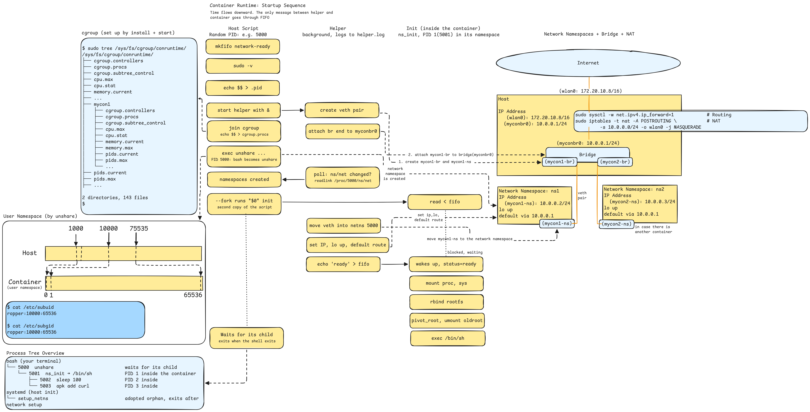

# Minimal Container Runtime

A container runtime written in Bash, built to understand what Docker does underneath.

One command gives you an isolated Alpine shell with internet access: a lightweight box you can
install anything in and throw away. No Docker, no `runc`, just raw Linux pieces: namespaces,
`pivot_root`, a user namespace for rootless operation, veth + bridge + NAT networking, and
cgroup v2 resource limits.



## What you get

```bash
./conruntime create mycon1
./conruntime start mycon1
```

```sh
/ # id
uid=0(root) gid=0(root)
/ # ps
PID   USER     TIME  COMMAND
    1 root      0:00 /bin/sh
    2 root      0:00 ps
/ # apk add curl
...
```

- **Isolated:** own processes (the shell is PID 1), own filesystem, own network.
- **Online:** reaches the internet through the host, so `apk` works.
- **Rootless:** root inside the container, your normal user outside.
- **Limited:** 256 MB memory, 64 processes, half a CPU.
- **Disposable:** `exit` stops it, `remove` deletes it.

## Requirements

- Linux with cgroup v2 (`stat -fc %T /sys/fs/cgroup` prints `cgroup2fs`)
- `util-linux` 2.38+ (for `unshare --map-users`), `nsenter`
- `iproute2`, `iptables`, `curl`, `tar`, `sudo`
- An entry for your user in `/etc/subuid` and `/etc/subgid`

## Usage

```bash
./conruntime install          # one-time host setup: bridge, NAT, parent cgroup
./conruntime create mycon1    # download and extract Alpine
./conruntime start mycon1     # start it and drop into its shell
./conruntime remove mycon1    # delete it (exit its shell first)
./conruntime uninstall        # undo the host setup
```

Container names are 1–12 characters: letters, digits, `_` or `-`.

## Configuration

Constants at the top of the script:

| Constant    | Default        | Meaning                                    |
|-------------|----------------|--------------------------------------------|
| `OUT_IFACE` | `wlan0`        | Host interface for NAT (find yours with `ip route show default`) |
| `BRIDGE`    | `myconbr0`     | Bridge the container connects to           |
| `SUBNET`    | `10.0.0.0/24`  | Container network                          |
| `MEM_MAX`   | `256M`         | Memory limit                               |
| `PIDS_MAX`  | `64`           | Process limit                              |
| `CPU_MAX`   | `50000 100000` | CPU limit (half a CPU)                     |

## How it works

`start` runs three cooperating processes:

1. **Host script:** creates a FIFO, starts the network helper in the background, joins the
   container's cgroup, then `exec`s `unshare` to create the namespaces. It keeps its PID and
   waits for the container to exit.
2. **Network helper:** creates a veth pair, attaches one end to the bridge, waits for the new
   network namespace, moves the other end into it, sets `10.0.0.2/24` and a default route, then
   writes `ready` to the FIFO.
3. **Container init:** PID 1 in the new namespaces. Blocks on the FIFO, mounts `/proc` and `/sys`,
   `pivot_root`s into the Alpine rootfs, and `exec`s `/bin/sh`.

When the shell exits, the kernel kills the remaining processes and tears down the namespaces,
veth pair and mounts. `remove` cleans up the files and the cgroup.

Each container lives in `~/.conruntime/<name>/`:

```
rootfs/          Alpine filesystem
basefs.tar.gz    downloaded image
.pid             PID of the running container
network-ready    FIFO used during startup
logs/helper.log  network helper output
```

## Limitations

- Every container gets `10.0.0.2`, so only one can run at a time.
- `/dev` is not populated.
- The outgoing interface is hardcoded (`OUT_IFACE`).
- Only one `/etc/subuid` / `/etc/subgid` line per user is supported.
- No cgroup namespace: limits are enforced but not visible inside the container.
- Alpine 3.19.1 x86_64 only.

